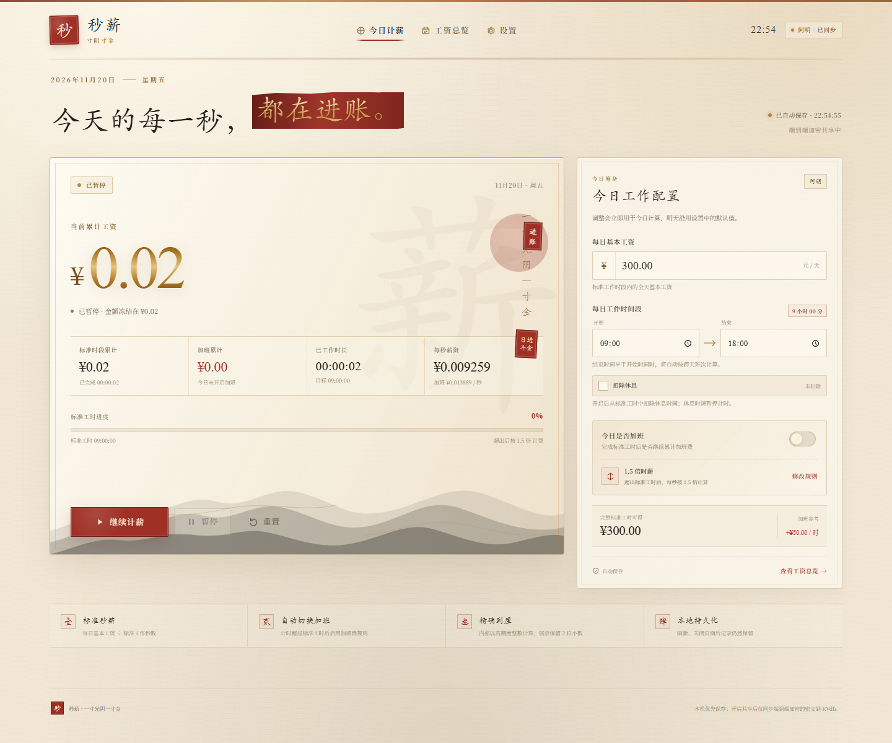
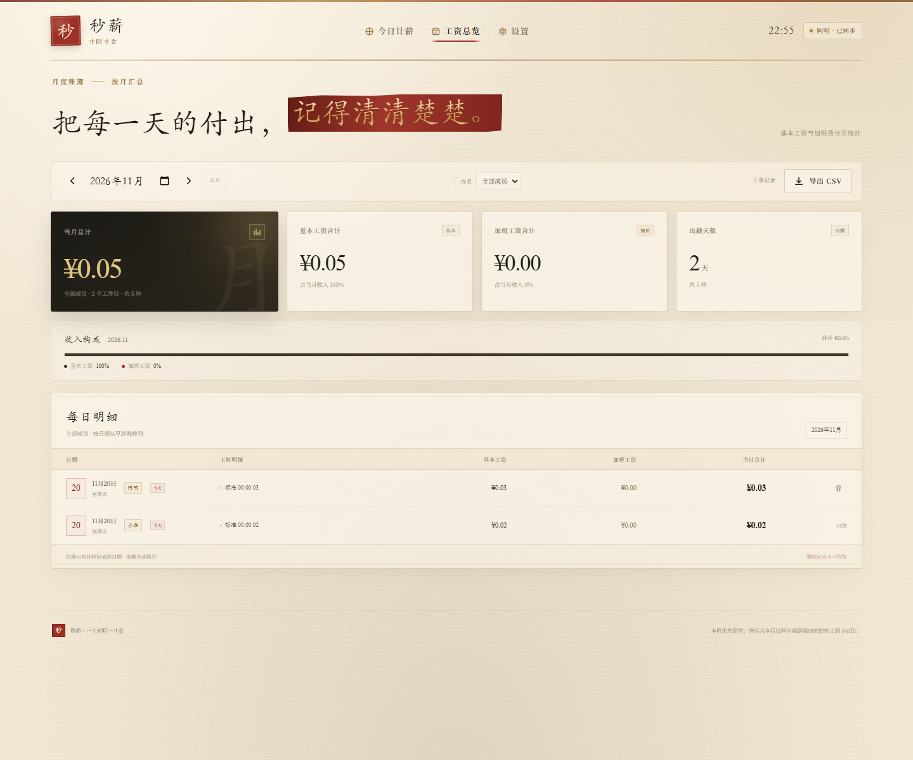
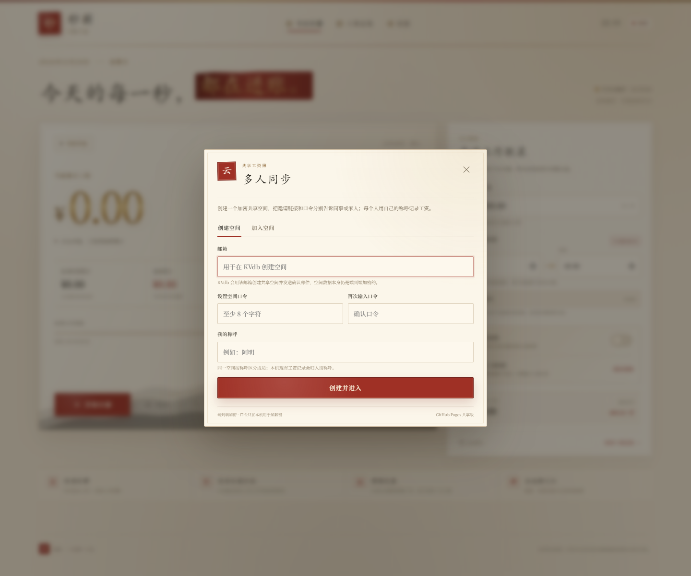

# 秒薪 · 按秒计薪工资计算器

一个无需自建后端、无需构建步骤的单页面工资计算工具。原生 HTML + CSS + JavaScript，视觉上采用宣纸、墨色、赤金与朱砂印章的中式账簿风格。

既能作为**本机工资计时器**使用，也能通过 GitHub Pages + KVdb 建立**端到端加密的多人共享工资簿**：多人打开同一个邀请链接、输入同一个空间口令，各自用称呼区分成员，按秒计薪、休息扣除和月度记录会在云端同步。

> 视觉主题：宣纸底色、墨色山水、赤金书法与朱砂印章。








## 快速开始

### 本机模式

直接双击打开 `index.html` 即可使用（Chromium / Edge / Chrome / Safari 的现代版本），不连接云端。

### 共享模式（推荐用 HTTP/HTTPS 打开）

共享功能依赖浏览器 Web Crypto，建议通过本地服务器或 GitHub Pages 访问：

```powershell
cd secondsalary
python -m http.server 8848
```

打开 <http://127.0.0.1:8848>，点击右上角「共享」。

本次已启动的本地预览地址：<http://127.0.0.1:8848>。

## 多人共享怎么用

1. 在「共享」弹窗中选择「创建空间」。
2. 填写邮箱（KVdb 用它创建免费存储桶）、空间口令、确认口令和你的称呼，点击「创建并进入」。
3. 创建完成后，复制邀请链接，把链接和空间口令**分开**告诉成员。
4. 其他成员打开邀请链接，输入空间口令和他们在共享工资簿中的称呼，即可加入。
5. 称呼相同会进入同一份成员账簿，因此同一个人换设备时填写同一个称呼，就能继续自己的工资记录。
6. 总览页的「查看」筛选可以切换「我的记录 / 全部成员」；全部成员视图会显示成员标签和合并后的月度总额。

## 功能

- **实时按秒计薪**：开始计时后，主金额随累计工时上涨；暂停冻结，继续接着累计。
- **完整计薪信息**：当前总额、标准时段累计、加班累计、已工作时长、标准秒薪、加班秒薪、标准工时进度。
- **今日配置**：每日基本工资、开始/结束时间、跨天班次识别、休息时间扣除、今日是否加班。
- **休息时间扣除**：设置和今日页都可开启，填写午休等不计薪时段；标准工时自动按「在岗时长 − 休息时长」计算。设置页保存时校验休息时间必须完整落在工作时段内，今日页在工作时段变化后会自动推荐合法休息时段。
- **加班规则**：设置中可切换「倍率」或「固定时薪」；保存后立即作用于后续计算。
- **工资总览**：按月份查看每日明细、基本工资合计、加班工资合计、当月总计、收入构成；支持前后月份切换。
- **多人共享**：同一加密空间内可保存多个成员各自的设置、工资记录和删除墓碑；支持「我的记录 / 全部成员」筛选。
- **导出与删除**：按月导出带 BOM 的 CSV（Excel 可直接打开，包含成员列），可删除自己的单日记录；删除今日记录会同时重置今日计时。
- **本地持久化**：设置、今日进度、每日记录自动写入 localStorage。刷新或关闭页面后不丢失；若关闭时正在计时，重新打开会恢复进度并自动暂停。
- **云端同步**：成员暂停计时、保存设置、删除记录时立即推送；计时运行期间自动推送，页面重新可见、网络恢复或点击「立即同步」时也会同步。
- **边界校验**：空金额、非数字、超过范围、开始/结束时间相同、缺失时间、错误口令、失效空间等都有字段提示和 Toast 提示。
- **清空数据**：设置页底部提供二次确认。清空本机数据会退出共享空间，但不会删除云端记录。

## 计薪规则

1. 在岗时长由「开始时间 → 结束时间」得到；结束时间早于开始时间时自动按跨天计算。
2. 开启「扣除休息」后，`标准工作秒数 =（在岗时长 − 休息时长）`。休息时段必须完整落在工作时段内，也支持跨天休息。
3. 计时按手动开始/暂停累计的秒数推进；休息时请手动暂停计时：
   - 累计时长 ≤ 标准工时：按 `每日基本工资 ÷ 标准工作秒数` 计算标准秒薪；
   - 累计时长 > 标准工时且开启「今日加班」：超出部分按加班规则计算；
   - 累计时长 > 标准工时但未开启加班：超出部分不计薪，但工作时长继续记录。
4. 加班倍率模式下：`加班秒薪 = 标准秒薪 × 倍率`。
5. 固定时薪模式下：`加班秒薪 = 固定加班时薪 ÷ 3600`。
6. 金额内部以「微厘」整数（1 厘 = 0.001 分）参与运算，避免浮点累计误差；界面工资四舍五入保留 2 位小数，秒薪展示 6 位小数。

> 说明：本工具采用「手动计时」语义。工作时段与休息设置共同决定标准工时长度和秒薪基准，计时从点击开始后累计，而不是根据当前钟点自动补算此前时长；休息时请手动暂停计时。

## 加密与云端同步

- **加密**：空间口令经 PBKDF2-SHA256（310,000 次）派生 256 位密钥，整份共享工资簿使用 AES-GCM 加密后再写入 KVdb。
- **分享链接**：只包含共享空间 ID（例如 `?space=...`），不包含空间口令。
- **服务商可见内容**：KVdb 只能看到密文、KDF 盐和 IV，看不到成员称呼、工资、工时和备注。
- **本机保存**：空间 ID、口令和当前成员称呼保存在本机 `localStorage` 的云端配置中，用于下次自动解锁。若设备被他人使用，建议退出共享空间或清空本地数据。
- **成员可见性**：同一空间内持有口令的成员可以查看彼此工资记录。如果每个人的工资需要互相保密，应各自创建独立空间。
- **删除同步**：删除记录会写入删除墓碑，其他设备同步后不会把旧记录重新带回来。
- **并发合并**：采用乐观合并，按记录更新时间合并；不同成员同时写入通常不会互相覆盖。极端同时写入仍可能后写者覆盖先写者。
- **KVdb 免费限制**：免费服务限制约 1,000 请求 / IP / 小时；本应用默认每 60 秒自动同步一次，并在关键操作时立即同步。多人处于同一公网 IP 时仍可能触及限制。
- **同一成员多设备**：建议同一成员同一时间只在一台设备上计时，避免两台设备同时累计同一天工时。

## 部署到 GitHub Pages

项目是纯静态站点，根目录已经包含 `.nojekyll`。

```powershell
cd secondsalary
git init -b main
git add .
git commit -m "feat: multiplayer encrypted salary ledger"
gh repo create xhzc66/secondsalary --public --source=. --remote=origin --push
gh api -X POST repos/xhzc66/secondsalary/pages -f "source[branch]=main" -f "source[path]=/"
```

部署后访问：<https://xhzc66.github.io/secondsalary/>。

共享模式不需要自建服务器；创建空间时，应用会通过 KVdb 自动生成免费存储桶。邀请成员只需要共享链接和空间口令。

## 文件结构

```text
secondsalary/
├─ index.html          页面结构、共享空间弹窗
├─ styles.css          宣纸墨金视觉、云共享组件与响应式
├─ js/
│  ├─ wage.js          时间解析、金额解析、计薪核心、格式化
│  ├─ storage.js       默认配置、localStorage 读写、数据校验、删除墓碑
│  ├─ cloud.js         PBKDF2 / AES-GCM 加密、KVdb 同步、成员与合并
│  └─ app.js           计时器、渲染、共享空间 UI、月度汇总、设置、弹窗
├─ screenshots/        预览截图
├─ .nojekyll           GitHub Pages 原样发布标记
└─ README.md
```

## 本地数据

localStorage key：

- `secondsalary.state.v1`：当前成员的本机工资状态（版本 3）。
- `secondsalary.cloud.config.v1`：共享空间 ID、口令、成员称呼。

本机状态结构（节选）：

```json
{
  "version": 3,
  "settings": {
    "defaultDailyWageCents": 30000,
    "workStart": "09:00",
    "workEnd": "18:00",
    "breakEnabled": true,
    "breakStart": "12:00",
    "breakEnd": "13:00",
    "overtimeMode": "multiplier",
    "overtimeMultiplierBps": 150,
    "overtimeHourlyCents": 5000
  },
  "settingsUpdatedAt": "2026-11-20T12:00:00.000Z",
  "today": {},
  "records": {},
  "deletedRecords": {}
}
```

云端加密明文结构（解密后）：

```json
{
  "version": 1,
  "revision": 3,
  "updatedAt": "2026-11-20T12:00:00.000Z",
  "members": {
    "阿明": {
      "id": "阿明",
      "name": "阿明",
      "settings": {},
      "settingsUpdatedAt": "2026-11-20T12:00:00.000Z",
      "records": {},
      "deletedRecords": {},
      "createdAt": "2026-11-20T12:00:00.000Z",
      "updatedAt": "2026-11-20T12:00:00.000Z"
    }
  }
}
```

所有金额字段均以「分」为整数保存，例如 `30000` 代表 ¥300.00。旧版本数据没有 `break*`、`settingsUpdatedAt` 或 `deletedRecords` 字段时会自动兼容读取。

## 已知限制

- KVdb 是第三方免费服务，无 SLA；服务不可用时使用本机记录，恢复网络后可重试同步。
- 口令丢失无法恢复，也没有服务端重置能力。
- 同一空间内成员可以查看彼此工资记录；隐私要求高时请一人一空间。
- 云端写入采用乐观合并，极端同时写入仍可能后写覆盖。
- 没有成员删除、改名、权限分级、历史版本恢复功能。
- 不支持在应用内修改空间口令（需新建空间）。

## 兼容性

- 推荐 Chrome / Edge 最新版。
- 共享模式需要 HTTPS 或 localhost 才能使用 Web Crypto。
- 使用原生 `<dialog>`、BigInt、`fetch`、Web Crypto、内联 SVG 山水/印章装饰与 CSS 纸张纹理，无外部图片依赖。
- 本机模式可离线使用；共享模式需要网络访问 KVdb。
