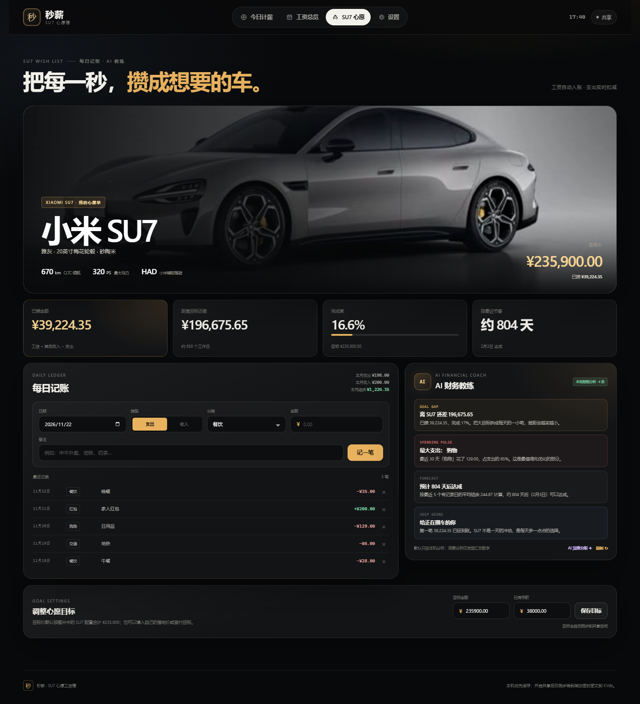
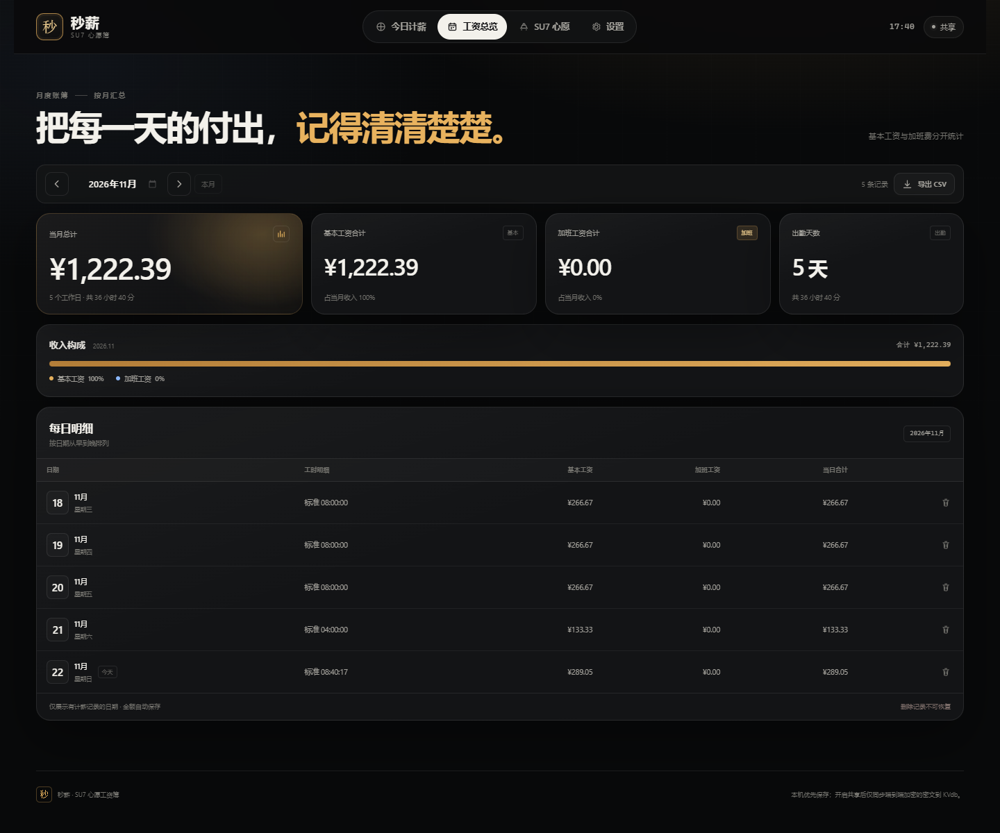
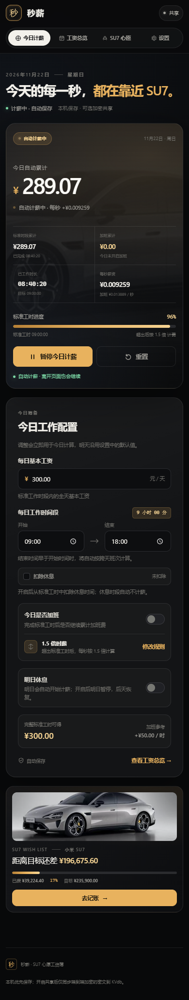
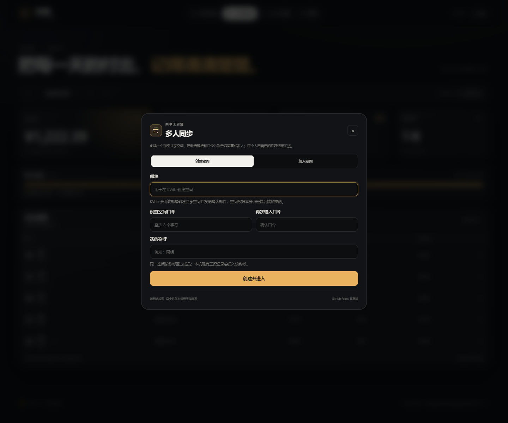

# 秒薪 · SU7 心愿工资簿

一个无需自建后端、无需构建步骤的单页面「自动计薪 + 心愿攒钱」工具。原生 HTML + CSS + JavaScript，视觉按小米 SU7 产品页的深色汽车风格重新设计：黑灰渐变、银白车身、赤金强调与产品参数式排版。

**线上入口**：<https://xhzc66.github.io/secondsalary/>  
**GitHub 仓库**：<https://github.com/xhzc66/secondsalary>

它把「每天自动进账的工资」「小米 SU7 心愿进度」「每日记账」「AI 消费提醒」和「多人加密共享」放在同一个工资簿里。










> SU7 图片来自你提供的配置单截图裁切，仅用于心愿单展示；车辆配置、价格与权益请以小米官方和实际订单为准。

## 这次新增了什么

- **全自动计薪**：不再需要点「开始计薪」。进入工作时段后按班次时钟自动累计，离开页面、切到后台或重新打开页面都会按时间补算。
- **明日休息**：今日页新增「明日休息」开关。开启后明日不自动计薪，后天自动恢复；休息日会同步到共享空间。
- **小米 SU7 心愿单**：默认目标价 ¥235,900，支持自定义目标金额与已有存款，实时显示已攒、还差、完成度和预计达成时间。
- **每日记账**：支出 / 收入、分类、金额、备注，按月汇总；支持软删除并同步到共享空间。
- **AI 财务教练**：本地智能分析会给出目标差距、消费提醒、达成预测和鼓励；也可以点击「AI 深度分析」，在确认后调用在线模型生成更自然的建议。
- **多人加密共享**：沿用 GitHub Pages + KVdb + 端到端加密方案；工资、心愿单、账本、休息日都按成员同步。

## 自动计薪规则

1. 每个工作日按「开始时间 → 结束时间」自动计薪；结束时间早于开始时间时自动按跨天班次处理。
2. 标准计薪秒数 = 班次在岗时间 − 休息时间。休息时段自动冻结，不需要手动暂停。
3. 计薪从班次开始时间起算，到当前时间为止；超过结束时间后，只有开启「今日加班」才继续计算加班费，加班自动计薪最多 8 小时。
4. 页面隐藏、切后台、锁屏或关闭后重新打开，都会用当前时钟重新计算，不依赖页面在前台持续运行。
5. 关闭页面跨过班次结束时，旧工作日会按班次结束时间结算；重新打开时，未打开期间的非休息工作日会按默认班次补记整天。若当天提前下班，请使用「暂停今日计薪」、重置或删除当天记录。
6. 「暂停今日计薪」会记录暂停区间，暂停时间不计薪；再次点击「恢复自动计薪」继续按班次计算。
7. 「重置」会删除今日记录，并从当前时刻重新开始自动计薪。
8. 跨天班次以班次开始日期作为工资记录日期。例如 22:00–06:00 的夜班，02:00 仍记在开始那一天。

### 休息日

- 在今日页打开「明日休息」后，明日不会自动计薪，也不会生成工资记录。
- 后天会自动恢复，不需要再次操作。
- 休息日标记带更新时间，可在共享空间同步；取消休息也会同步，不会被旧设备重新加回来。
- 默认没有自动把周六、周日设为休息；如果需要，请在当天提前打开「明日休息」。

## SU7 心愿单

- 默认目标价：¥235,900.00（来自参考配置单的车辆总价）。
- 可修改目标金额和「已有存款」，适合改为首付目标或自己的落地价。
- 心愿进度公式：`已有存款 + 工资记录合计 + 其他收入 − 支出`。
- 工资记录来自自动计薪；当天记录每 5 秒左右落盘一次，心愿进度会随之更新。
- 预计达成时间按最近 14 天中有记录日的平均结余估算，只作节奏参考，不是财务承诺。

## 每日记账

- 支持「支出」和「收入」两类；支出分类包括餐饮、交通、购物、居住、娱乐、学习、医疗、其他支出。
- 每笔记录包含日期、类型、分类、金额和备注；本月支出、本月收入、本月结余会实时汇总。
- 删除采用软删除：记录标记为 deleted 后从界面消失，并通过更新时间同步到其他设备，避免旧设备把删除项带回来。
- 账本按成员区分，界面只显示当前成员的账本；但同一空间内持有口令的成员在技术上都能解密整份共享数据，因此需要完全保密时请一人一空间。

## AI 财务教练

默认使用**本地智能分析**，不上传账本，不依赖外部模型。它会根据目标差距、消费分类、最近 14 天支出和结余，生成四类提示：

- 目标差距与完成度；
- 最大支出分类 / 消费节奏提醒；
- 按最近结余估算的达成时间；
- 一条不油腻的攒钱鼓励。

点击「AI 深度分析」并确认后，会把**汇总数字**（目标、已攒、还差、本月支出、最大分类、预计天数等）发送到 Pollinations 的在线模型，生成一段更自然的三句话建议。**不会发送姓名、成员称呼、备注或逐笔明细**。在线服务不可用时会保留本地建议。

在线 AI 是可选增强，涉及第三方服务；如果不想发送任何数据，只使用本地分析即可。

## 多人共享

沿用之前的 GitHub 方案：GitHub Pages 静态托管 + KVdb 免费存储桶 + Web Crypto 端到端加密。

1. 点击右上角「共享」→「创建空间」。
2. 填写邮箱（KVdb 创建存储桶用）、空间口令和你的称呼。
3. 创建后复制邀请链接，把链接和口令**分开**告诉成员。
4. 成员打开链接，输入口令和称呼加入；称呼相同会进入同一成员账簿。
5. 工资总览的「查看」可切换「我的记录 / 全部成员」。

同步范围包括：

- 每个成员的工资记录和删除墓碑；
- 心愿目标、已有存款；
- 每日账本（含软删除）；
- 休息日及休息日取消记录；
- 今日工资记录里的暂停区间。

### 加密与隐私

- 空间口令经 PBKDF2-SHA256（310,000 次）派生 256 位密钥，整份共享数据使用 AES-GCM 加密后写入 KVdb。
- 邀请链接只包含空间 ID，不包含口令。
- KVdb 只能看到密文、盐和 IV，看不到成员称呼、工资、心愿单和账本。
- 同一空间内持有口令的成员可以查看彼此的工资、心愿单和账本记录。需要完全隐私时，请各自创建独立空间。
- 口令丢失无法恢复；本机为了自动重连会把空间 ID、口令和称呼保存在 localStorage。

### 同步频率

- 暂停、保存设置、记账、修改心愿目标、切换休息日、删除记录时会立即触发同步。
- 自动计薪运行期间每 60 秒自动同步一次；页面重新可见、网络恢复时也会尝试同步。
- KVdb 免费额度约 1,000 请求 / IP / 小时；多人共用一个公网 IP 时仍可能触发限制。

## 快速开始

本机模式直接双击 `index.html` 即可。共享模式和在线 AI 建议通过 HTTP/HTTPS 打开：

```powershell
cd secondsalary
python -m http.server 8848
```

启动后打开 <http://127.0.0.1:8848>。

## 部署到 GitHub Pages

项目是纯静态站点，根目录包含 `.nojekyll`。

```powershell
cd secondsalary
git init -b main
git add .
git commit -m "feat: SU7 wishlist and AI savings coach"
gh repo create xhzc66/secondsalary --public --source=. --remote=origin --push
gh api -X POST repos/xhzc66/secondsalary/pages -f "source[branch]=main" -f "source[path]=/"
```

更新已有仓库时直接 `git push origin main`，GitHub Pages 会自动重新构建。

## 文件结构

```text
secondsalary/
├─ index.html          页面结构、SU7 心愿单、记账与共享弹窗
├─ styles.css          深色汽车产品页视觉与响应式
├─ assets/
│  └─ su7.jpg          从参考配置单裁切的小米 SU7 图片
├─ js/
│  ├─ wage.js          时间/金额解析、自动计薪核心、格式化
│  ├─ storage.js       默认配置、localStorage、数据校验与迁移
│  ├─ cloud.js         PBKDF2 / AES-GCM、KVdb 同步、成员合并
│  ├─ ai.js            本地 AI 财务分析与可选在线建议
│  └─ app.js           自动计薪、渲染、心愿单、账本、交互
├─ screenshots/        预览截图
├─ .nojekyll           GitHub Pages 原样发布标记
├─ .gitignore
└─ README.md
```

## 本地数据

localStorage key：

- `secondsalary.state.v1`：本机工资状态（版本 4）。
- `secondsalary.cloud.config.v1`：共享空间 ID、口令、成员称呼。

状态结构（节选）：

```json
{
  "version": 4,
  "settings": {},
  "settingsUpdatedAt": "2026-11-22T10:00:00.000Z",
  "today": {
    "date": "2026-11-22",
    "pauseIntervals": [],
    "overtimeEnabled": false
  },
  "records": {},
  "deletedRecords": {},
  "restDays": { "2026-11-23": true },
  "restDayUpdated": { "2026-11-23": "2026-11-22T10:00:00.000Z" },
  "wishlist": {
    "targetCents": 23590000,
    "initialSavedCents": 0,
    "title": "小米 SU7",
    "subtitle": "雅灰 · 20英寸梅花轮毂 · 砂陶米"
  },
  "ledger": {}
}
```

金额字段均以「分」为整数保存，例如 `23590000` 代表 ¥235,900.00。旧版本数据会自动补齐心愿单、账本和休息日字段。

云端加密后的明文结构（解密后，节选）：

```json
{
  "version": 1,
  "revision": 12,
  "members": {
    "阿明": {
      "name": "阿明",
      "settings": {},
      "settingsUpdatedAt": "2026-11-22T10:00:00.000Z",
      "records": {},
      "deletedRecords": {},
      "restDays": { "2026-11-23": true },
      "restDayUpdated": { "2026-11-23": "2026-11-22T10:00:00.000Z" },
      "wishlist": {},
      "ledger": {}
    }
  }
}
```

工资记录中的 `pauseIntervals` 也会随记录同步，保证换设备后暂停区间仍然生效。

## 已知限制

- 自动计薪按班次时钟推演，不是真实考勤；提前下班、临时离岗请用暂停、重置或删除当天记录修正。
- 关闭页面跨过班次结束时，旧工作日会按完整班次结算；多日未打开会补记非休息工作日。
- 同一成员建议只在一台设备上自动计薪，避免两台设备同时推同一成员记录造成后写覆盖。
- KVdb 是第三方免费服务，无 SLA；离线时继续本机记录，恢复网络后重试。
- 在线 AI 依赖 Pollinations 第三方服务，可能限流或不可用；不会影响本地 AI 分析。
- 同一空间内的成员彼此可见工资记录；需要完全保密时请一人一空间。

## 兼容性

- 推荐 Chrome / Edge 最新版。
- 共享模式和在线 AI 需要 HTTPS 或 localhost；本机模式可离线使用。
- 使用原生 `<dialog>`、BigInt、Web Crypto、`fetch`、内联 SVG 与 CSS，无前端框架、无构建步骤。
